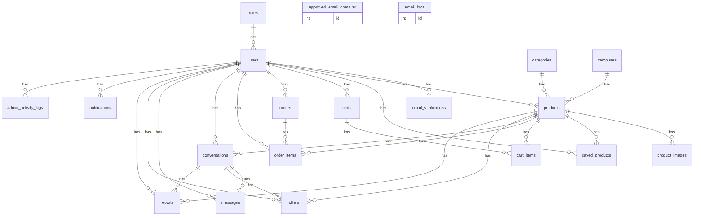
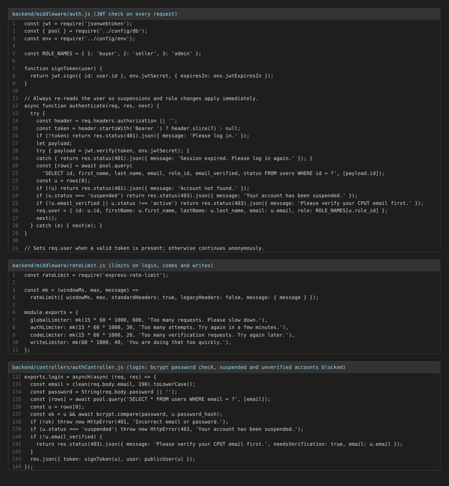

# Xolile Ludidi

## 💼 Entry-Level Multimedia / Web / Application Developer (Junior)

## 🎯 Objective
Motivated entry-level developer with foundational skills in PHP, Java, HTML, CSS, and JavaScript. Currently building practical projects and strengthening problem-solving, UI/UX, and backend fundamentals. Known for discipline, fast learning, and a strong desire to grow into a professional software developer within a supportive team.

## 📧 Contact
- Email: 240055667@mycput.ac.za  
- Phone: 0835092945  
- Address: 14 Ravenscraig Rd, Woodstock  

## 💻 Technical Skills

### Programming & Web
- PHP (Beginner)  
- Java (Intermediate)  
- HTML5, CSS3, JavaScript  

### Tools & Concepts
- VS Code  
- XAMPP  
- Figma  
- Git & GitHub (Basic)  
- Form Validation  
- UI/UX Principles  
- Adobe Software (Illustrator, InDesign, Photoshop)  

## 🎓 Education
**Diploma in ICT: Multimedia Applications (In Progress)**  
- Cape Peninsula University of Technology  

**Matric Certificate (2021)**  
- Modiri Secondary School  

## 📜 References
**Meagan Hamman**  
- Lecturer, Diploma in ICT  
- Cape Peninsula University of Technology  
- Email: hammanm@cput.ac.za  
- Phone: 0833819056

## 🎥 Mock Interview

Click the image below to watch my mock interview.

## 1. Reflection on Coding in Markdown

**Situation:**  
I needed to create a digital portfolio for my assessment using GitHub and Markdown.

**Task:**  
My goal was to convert my CV into a structured, web-ready format using GitHub Flavored Markdown.

**Action:**  
I used headers, bullet points, and hyperlinks to organize my professional information and technical skills.

**Result:**  
I produced a professional, responsive document that integrates with GitHub Pages.

## 2. Reflection on Mock Interview Video Experience

**Situation:**  
I participated in a mock interview as part of my work readiness training.

**Task:**  
My objective was to demonstrate professional communication skills for my portfolio.

**Action:**  
I found the process challenging and recorded it twice after learning from my first attempt.

**Result:**  
I successfully completed the video and gained a better understanding of how to present my skills.

## 3. Reflection on the Use of GitHub Pages

**Situation:**  
The assessment required a live, accessible link to my digital portfolio.

**Task:**  
I had to host my Markdown-based CV and reflections on a public platform.

**Action:**  
I configured GitHub Pages to build my site automatically from the main branch.

**Result:**  
My portfolio is now live and professional, providing an easy way for others to view my work.

---

# Project Presentation 3: Agile Portfolio (UniMarket)

**Project:** UniMarket, a student-to-student marketplace for CPUT students to buy and sell second-hand textbooks, laptops, calculators and other study materials.
**My role:** Backend Designer (database design, security and login, API planning, with some UI/UX sketches).

---

## 1. Agile Team Charter

### Reflection

Our team charter says we work as one group with shared responsibility. My assigned role was Backend Designer, so I looked after the database design, the login and security side, and the sketches that showed which data each screen needed. I did not attend every standup, so I caught up through the team chat and the Trello board. That showed me the charter only works when everyone keeps checking in. When the UI designers changed a screen, my tables sometimes no longer matched, and I had to adjust my sketches. I learned to tell the team straight away when I changed something in the backend, so the screens and the data stayed in line. In the pitch we agreed who would answer which questions, and I took the ones about security and the database.

### Evidence

<!-- ADD YOUR TEAM ROLES / CHARTER SCREENSHOT HERE: save it as images/team-charter.png, delete this comment line and the next one, then remove the arrows around the next line -->
<!--  -->

Team members' roles in the charter, and my role as Backend Designer.

- [View Logbook: 28–31 July 2026](logbooks/Xolile_Ludidi_Logbook_28-31_July_2026.pdf)
- [View Logbook: 4–7 August 2026](logbooks/Xolile_Ludidi_Logbook_4-7_August_2026.pdf)

---

## 2. User Stories and Tasks

### Reflection

User stories helped me look at UniMarket from a student's point of view instead of only thinking about tables and code. Each story became backend tasks for me, for example "As a student, I want to sign up with my CPUT email so that only real students can use the platform" became tasks for the email check, the verification code and the password hashing. I sketched the database first, then checked each story against it to make sure the data was there. The biggest problem was keeping the sketches up to date while the screens kept changing. I learned that a good user story is small enough to turn into clear tasks, and that the backend and the screens must be designed together.

### Evidence

| # | User story | My backend tasks |
|---|-----------|------------------|
| 1 | As a student, I want to sign up with my CPUT email so that only real students can use the platform. | Check the approved email domain; store the user; create and hash a 6-digit code; hash passwords with bcrypt |
| 2 | As a student, I want to log in securely so that my account and messages stay private. | Login route; JWT token; block suspended and unverified accounts; limit login attempts |
| 3 | As a seller, I want to list an item with photos and a price so that other students can find it. | Products and product_images tables; validate price and uploads (type and size) |
| 4 | As a buyer, I want to search and filter by category, price, condition and campus so that I find items quickly. | Categories and campuses tables; search and filter query; pagination |
| 5 | As a buyer, I want to message a seller and make an offer so that we agree on a price. | Conversations, messages and offers tables; accept, reject and counter offer |
| 6 | As a buyer, I want to add items to a cart and reserve them so that I can collect them on campus. | Carts, cart_items and orders tables; transaction at checkout |
| 7 | As an admin, I want to suspend users and review reports so that the platform stays safe. | Reports table; admin routes; activity log |

**My database design sketches turned into the final database diagram (20 tables):**

- [View Logbook: 21–24 July 2026](logbooks/Xolile_Ludidi_Logbook_21-24_July_2026.pdf)

---

## 3. Product Backlog

### Reflection

The Product Backlog helped us decide what UniMarket needed first and what could wait. We put sign-up, login, listing items and browsing at the top because nothing else works without them. Messaging, offers, the cart and the admin tools came next, and online payment was left out on purpose because it would need a payment gateway, so orders are reservations that students collect on campus. From the backend side, the priority order also decided the order of my work: security and the database first, then the extra features. The difficulty was that the screens and the data changed while the backlog was being set, so I had to review my priorities again with the team. I learned that a backlog is a living list, not a fixed plan.

### Evidence

| Priority | Backlog item | Status |
|----------|--------------|--------|
| 1 | CPUT email sign-up and email verification code | Done |
| 2 | Secure login (JWT, bcrypt, limits on attempts) | Done |
| 3 | Database design (users, roles, products, categories, campuses) | Done |
| 4 | List an item with photos and price (create, edit, delete) | Done |
| 5 | Marketplace search, filters, sorting and pagination | Done |
| 6 | Messaging and offers between buyer and seller | Done |
| 7 | Cart, checkout and order history (reservation only) | Done |
| 8 | Reports and admin dashboard (suspend users, review reports) | Done |
| 9 | Online payments (PayFast or Yoco) | Left out for now |

<!-- ADD YOUR TRELLO BOARD SCREENSHOT HERE: save it as images/trello-board.png, then remove the arrows around the next line -->
<!--  -->

- [View Logbook: 28–31 July 2026](logbooks/Xolile_Ludidi_Logbook_28-31_July_2026.pdf)
- [View Logbook: 4–7 August 2026](logbooks/Xolile_Ludidi_Logbook_4-7_August_2026.pdf)

---

## 4. Sprint Backlog

### Reflection

The Sprint Backlog broke the plan into small tasks I could finish in a week. In the week of 21 July, my tasks were the sketches and the database design. In the week of 28 July, they were the schema, login, email codes and the security settings. That week the security settings did not load properly at first, because the secret key in the .env file was not being picked up. I fixed it, but then the login and sign-up screens had to be updated because the backend sent new error messages. In the week of 4 August, my tasks were my pitch section and rehearsal. I learned that one problem in the backend can create work for the front end, and that I need to tell the team earlier.

### Evidence

| Sprint | Dates | My tasks | Result |
|--------|-------|----------|--------|
| 1 | 21–24 July 2026 | Sketch the main data; design the tables and the API routes | Done |
| 2 | 28–31 July 2026 | Write the schema; register, login and email code routes; set up security (JWT, bcrypt, limits, .env); update the login screens with the UI team | Done, after fixing the .env loading problem |
| 3 | 4–7 August 2026 | Prepare my security and database talking points; match slides to the design style; rehearse the pitch | Done |

**The security work from Sprint 2 (login token check, request limits and password check):**

- [View Logbook: 21–24 July 2026](logbooks/Xolile_Ludidi_Logbook_21-24_July_2026.pdf)
- [View Logbook: 28–31 July 2026](logbooks/Xolile_Ludidi_Logbook_28-31_July_2026.pdf)
- [View Logbook: 4–7 August 2026](logbooks/Xolile_Ludidi_Logbook_4-7_August_2026.pdf)

---

## 5. Agile Logbook

### Reflection

My Agile logbook recorded what I completed, what I planned next and what blocked me. I did not attend every standup, but the entries show how my work moved from sketches in the first week, to the schema and security in the second week, and to the pitch in the third. Two problems appear again and again: the security settings not loading, and updating the UI and UX to match backend changes. Writing them down helped me see that both came from not telling the team early enough. The logbook also showed me where I was strong, which was the backend design and planning, and where I need to improve, which is communication and attending standups. Next time I will write the entry on the same day, so nothing is forgotten.

### Evidence

| Sprint | Focus | Logbook |
|--------|-------|---------|
| 1 | Sketches and database design | [View Logbook: 21–24 July 2026](logbooks/Xolile_Ludidi_Logbook_21-24_July_2026.pdf) |
| 2 | Schema, login and security; updating the UI and UX | [View Logbook: 28–31 July 2026](logbooks/Xolile_Ludidi_Logbook_28-31_July_2026.pdf) |
| 3 | Pitch preparation and rehearsal | [View Logbook: 4–7 August 2026](logbooks/Xolile_Ludidi_Logbook_4-7_August_2026.pdf) |
